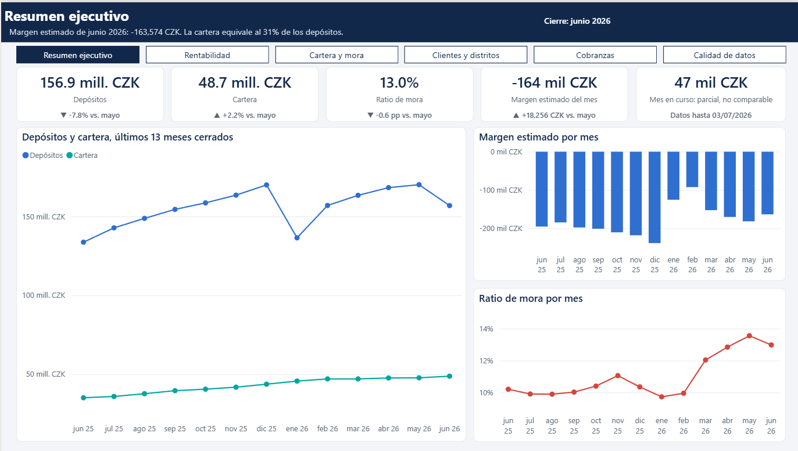

# Banco Analítico

Banco simulado de punta a punta: cada día hábil llegan datos nuevos, se validan, se cargan en un data warehouse en Azure SQL y actualizan reportes en Power BI y Excel.

**Estado:** el almacén está en Azure SQL y GitHub Actions carga un día hábil simulado de lunes a viernes. La app de cobranzas ya registra gestiones y el reporte de Power BI tiene sus 6 páginas en Desktop, aún sin publicar. Excel aún no empieza.



## Empieza por aquí

| Documento | Para qué sirve |
| --- | --- |
| [Plan de proyecto](docs/01%20Plan%20de%20proyecto.docx) | Qué se construye, por qué y en qué orden |
| [Guía paso a paso](docs/02%20Guia%20paso%20a%20paso.docx) | Qué poner en cada pantalla y qué no poner |
| [Diccionario de datos de origen](docs/03_diccionario_datos_origen.md) | Significado de cada archivo, columna y código de Berka |
| [Hallazgos del análisis](docs/04_hallazgos_eda.md) | Qué se aprendió de los datos y qué decisiones cambió |

El plan vivo está en [claude.ai](https://claude.ai/artifact/69AWDEokwnSoV7P5vgumEx). El archivo Word es una copia de ese plan.

## Tecnología

| Parte | Herramienta |
| --- | --- |
| ETL y análisis exploratorio | Python |
| Data warehouse | SQL Server en local, Azure SQL Database en la nube |
| Orquestación | GitHub Actions |
| Reportes | Power BI y Excel |
| Avisos y operación | Power Automate y Power Apps |

## Datos

El proyecto usa el dataset Berka del PKDD'99: datos anonimizados de un banco checo entre 1993 y 1998.

Los archivos están en `data/raw/berka/` y no se suben al repositorio.

Berka no incluye intereses de préstamos, porque en los 682 préstamos la cuota por el plazo es igual al monto. Por eso el margen financiero usa una tasa supuesta y se presenta como estimado.

## Cómo ejecutarlo en local

Necesitas Python 3.12 y SQL Server LocalDB. Los archivos de Berka van en `data/raw/berka/`.

```powershell
python -m venv .venv
.\.venv\Scripts\python.exe -m pip install -r requirements.txt
Copy-Item .env.example .env
$env:PYTHONPATH = "src"

.\.venv\Scripts\python.exe -m banco.etl preparar    # crea la base y sus objetos
.\.venv\Scripts\python.exe -m banco.etl historico   # carga hasta el 30 de junio de 2026
.\.venv\Scripts\python.exe -m banco.etl siguiente   # procesa el próximo día hábil

.\.venv\Scripts\python.exe -m pytest                # corre todas las pruebas
```

La carga del histórico tarda unos 6 minutos.

## Estructura

```text
.
├── data/raw/berka/   Archivos originales, sin modificar
├── data/landing/     Archivos que publica el simulador
├── docs/             Plan, guía, diccionario, hallazgos y capturas
├── infra/            Scripts para desplegar en Azure y dar acceso a GitHub Actions
├── notebooks/        Análisis exploratorio
├── powerapps/        Fórmulas de la app de cobranzas
├── powerautomate/    Esquema del aviso de carga
├── powerbi/          Proyecto de Power BI y el script que lo genera
├── sql/              Tablas, procedimientos, vistas y datos de referencia
├── src/banco/        Simulador y carga
└── tests/            Pruebas
```
